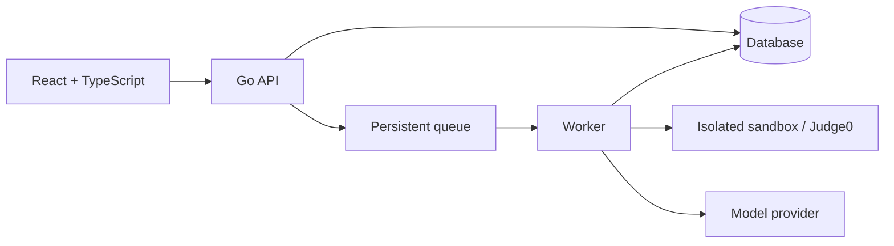

# PA2 Plan

**Deadline:** Wednesday, November 11, 2026, at 22:00.  
**Goal:** Prepare the development harness, a working quality gate, and the contract and tests for one LeeTKOB endpoint.

## 1. Choose the stack and endpoint

**Description:** Choose the project's technologies and one endpoint for PA2.

**Input:** React, TypeScript, Go, the project brief, and team preferences.

**Expected output:** A documented stack, deployment plan, and PA2 endpoint.

### Stack decisions

| Area | Proposed choice | Reason / review points |
|---|---|---|
| Frontend | **React + TypeScript**; Vite, React Router, npm | Vite provides a small development and build setup. Use plain CSS initially. |
| Backend | **Go**; Chi, Go modules, standard JSON handling, `testing` and `net/http/httptest` | Chi offers routes and middleware with Go's `net/http`. Validate requests explicitly. Use Vite's development proxy and Caddy's `/api` reverse proxy in deployment. |
| Database | PostgreSQL, `pgx`, sqlc, and Goose migrations | Write SQL and generate typed Go access; migrations track schema changes. Use PostgreSQL in Docker for local development. Use transactions and unique constraints for idempotency. |
| Authentication | SCS server-side sessions stored in PostgreSQL; secure HTTP-only cookies; Argon2id for passwords | Keep sessions on the server. Add CSRF protection, rate limits, and backend checks for role, class membership, and ownership. SCS handles sessions; the team must implement or adopt account and password flows. |
| Queue and worker | River with PostgreSQL; separate Go worker | Start with two concurrent jobs and up to three attempts for transient failures; tune using load tests. Store failures for inspection and make job processing idempotent. |
| Sandbox | Self-hosted Judge0 on a dedicated VM | Provides an existing judging system. Verify every brief requirement with attack tests; Judge0 alone is not proof of compliance. |
| Model review | Google Gemini 3.8 Flash as an eval candidate; provisional $10 project budget | Compare on the dev set before committing. Confirm provider privacy terms and configure an enforceable cap if supported; otherwise enforce a per-lab application budget. Estimate cost after measuring token use. |
| Deployment | Hetzner Cloud Linux VMs: one for React, Go API, worker, and PostgreSQL; one for Judge0; Docker Compose and Caddy | Serve the frontend and API under one HTTPS origin. Back up PostgreSQL, restrict Judge0 access, and check capacity and pricing before provisioning. |
| Live updates | Short-interval polling of a protected submission-status endpoint | Simple to implement; measure freshness and request load during the 80-submission test. |
| Quality tools | Go: `golangci-lint`, `gofmt`, `go vet`, `go test`; frontend: ESLint, Prettier, TypeScript, Vitest; CI: GitHub Actions | Document one command per check and run the same commands in CI. |
| PA2 endpoint | `POST /labs/{labId}/submissions` | Define role, enrollment, request rules, RFC 9457 errors, and idempotency. Implement and test the chosen contract. |

These are the team's **planning choices**. Validate model data handling before sending student code. The model, budget, worker limits, and VM capacity must be checked against the dev set and load test.

References: [River](https://riverqueue.com/docs), [sqlc](https://docs.sqlc.dev/), [SCS](https://github.com/alexedwards/scs), [Judge0](https://ce.judge0.com/), and [Gemini pricing and data terms](https://ai.google.dev/gemini-api/docs/pricing).

### Proposed system flow

The queue, worker, sandbox, and model feature are planned for later milestones. PA2 focuses on one endpoint and the quality gate.

### Checklist

- [x] Choose React with TypeScript and a Go backend.
- [x] Choose frontend build, routing, package, and UI tools.
- [x] Choose Go routing, validation, testing, and API access tools.
- [x] Choose the database, driver, query approach, migrations, and local setup.
- [x] Choose authentication and plan role and ownership checks.
- [x] Plan the queue, worker, retries, and initial concurrency limits.
- [x] Choose Judge0 and plan attack tests for every sandbox minimum in the brief.
- [x] Select a model candidate and provisional budget; measure cost per lab during evaluation.
- [x] Plan hosting, secrets, live updates, logs, metrics, traces, and load testing.
- [x] Choose quality tools and one PA2 endpoint; record the tradeoffs.

## 2. Set up the repository

**Description:** Create the project configuration and make the project reproducible for a fresh clone.

**Input:** The chosen stack. List required environment variables without values in `.env.example`; ignore `.env` and generated files in `.gitignore`.

**Expected output:** A project that can be installed using the README, with secrets kept out of the repository. The README states the chosen model and its spending cap and estimated cost per lab once decided.

- [x] Add initial frontend, Go module, and local database configuration.
- [x] Create `.gitignore` and `.env.example`.
- [x] Start local PostgreSQL and confirm it accepts connections (host port 5433).
- [x] Clone the pushed repository, install frontend dependencies, and build the frontend. PostgreSQL was checked in the original workspace.
- [ ] Configure an enforceable spending cap and measure cost per lab; the README has an illustrative estimate.
- [ ] Complete a secret review of the tree and history. A pattern scan found no common key formats before the initial commit. Rotate any exposed secret and record it in `AI-LOG.md`.

## 3. Write assistant rules and permissions

**Description:** Tell the team's assistant how to work on LeeTKOB and which actions require permission.

**Input:** The chosen stack and project risks. Use `AGENTS.md` or another rules file that the team's tools read. Examples: no secrets in the sandbox, no real model calls in unit tests, and never change tests, eval data, or labels merely to pass a check.

**Expected output:** A short rules file with **stack, commands, conventions, and never** sections, plus **allowed, ask first, and never** permission tiers. At least two rules are traceable to real problems in commits or `AI-LOG.md`.

- [ ] Write the four rules sections and three permission tiers.
- [ ] Record actual problems and link at least two resulting rules to evidence.

## 4. Write the endpoint contract

**Description:** Specify the chosen endpoint so another developer can build a client from the document.

**Input:** The chosen endpoint, the LeeTKOB brief, and the sections in IA3's `CONTRACT.md`. For example, a submissions contract should define how an idempotency key behaves on retries.

**Expected output:** `docs/contract/<endpoint>.md` describing authorization and ownership, request and response fields and rules, every error as RFC 9457 problem details with its status, paging or idempotency where applicable, and how changes are handled.

- [ ] Define the caller's role and ownership rules.
- [ ] Define requests, responses, field rules, and examples.
- [ ] List each error type and status using problem details.
- [ ] Define paging or idempotency where applicable, and the change policy.

## 5. Implement the endpoint and contract tests

**Description:** Build enough endpoint behavior to satisfy the contract, and test the contract's promises.

**Input:** The completed contract and chosen test tools. For example, test that a student cannot access another student's submission and that a repeated upload does not create another submission, if those rules apply.

**Expected output:** An endpoint implementation and automated contract tests covering success, each documented error, ownership, and paging or idempotency where applicable.

- [ ] Implement the endpoint according to the contract.
- [ ] Test the success path, response fields, and every documented error type.
- [ ] Test ownership and paging or idempotency where applicable.
- [ ] Keep tests aligned with the contract; do not weaken them just to pass.

## 6. Set up local checks and CI

**Description:** Make the same quality checks available locally and on every pull request, and require them before merging.

**Input:** The stack's lint, format, type-checking, and test tools. For example, use one package script per check and call those scripts from CI.

**Expected output:** A fresh clone can follow the README to run each check successfully, and protected `main` requires the same checks before a PR can merge.

- [ ] Document one command each for lint, format check, type check if applicable, and tests.
- [ ] Run those same commands in CI on pull requests.
- [ ] Protect `main` and require the checks; avoid direct pushes after protection is enabled.
- [ ] Save a link or screenshot showing branch protection.

## 7. Collect evidence that the gate works

**Description:** Demonstrate that a failing check prevents a merge and that contract tests detect a real violation.

**Input:** The required CI checks and contract tests. For example, deliberately break the endpoint's documented ownership or idempotency behavior without weakening its tests, then fix the code.

**Expected output:** Links to a blocked PR, the deliberate contract break and its failing CI run, and the commit or PR that restores passing checks.

- [ ] Introduce a deliberate contract violation and record the commit or PR.
- [ ] Confirm CI fails and the required check blocks merging; save the evidence.
- [ ] Fix the violation and record the green commit or PR and CI run.

## 8. Complete the records

**Description:** Explain the team's use of assistants and give the marker direct evidence for each criterion.

**Input:** Actual work, decisions, commits, PRs, CI runs, and branch protection evidence. Use the self-assessment template on Classroom.

**Expected output:** `AI-LOG.md`, root-level `PA2.md`, and `SELF_ASSESSMENT_REPORT.md` with honest scores and evidence.

- [ ] Record tools and their uses, with real Changed and Rejected entries in `AI-LOG.md`.
- [ ] Link the repository, branch protection, blocked PR, green PR, tag CI run, and deliberate contract break in `PA2.md`.
- [ ] Score every rubric criterion with evidence and note what was not completed in `SELF_ASSESSMENT_REPORT.md`.
- [ ] Ensure the claimed total matches the total used in the ZIP filename.

## 9. Prepare and submit

**Description:** Freeze the final submission and package the repository for grading.

**Input:** The completed repository, evidence links, student IDs, and self-assessed total. Use student IDs in ascending order.

**Expected output:** A public repository with a pushed `pa2` tag and a ZIP containing the repository, `.git`, and the self-assessment report, submitted by one team member from their student Google account.

- [ ] Make the repository public and confirm the final checks pass.
- [ ] Tag the submission commit `pa2`, push the tag, and link its CI run in `PA2.md`.
- [ ] Package the repository including `.git` as `<StudentID1>-<StudentID2>-<StudentID3>_<total>.zip`, using the IDs of your team members.
- [ ] Confirm the ZIP includes `SELF_ASSESSMENT_REPORT.md` and submit it from one member's student Google account.

**Tag note:** `PA2.md` must link to the tag's CI run. Arrange the final commit and tag workflow so the tagged commit contains the required evidence; if the tag CI link is not known in advance, document how to locate the run from the tag and include the direct link when available.
