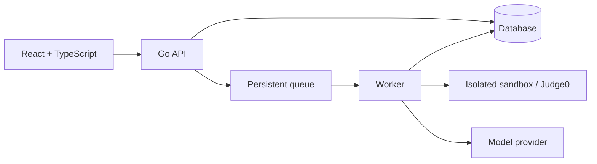

# PA2 Plan

**Deadline:** Wednesday, November 11, 2026, at 22:00.  
**Goal:** Prepare the development harness, a working quality gate, and the contract and tests for one LeeTKOB endpoint.

## 1. Choose the stack and endpoint

**Description:** Choose the project's technologies and one endpoint for PA2.

**Input:** React, TypeScript, Go, the project brief, and team preferences.

**Expected output:** A documented stack, deployment plan, and PA2 endpoint.

### Stack decisions

| Area | Proposed choice | Reason / review points |
|---|---|---|
| Frontend | **React + TypeScript**; Vite, React Router, npm | Vite provides a small development and build setup. Use plain CSS initially. |
| Backend | **Go**; Chi, Go modules, standard JSON handling, `testing` and `net/http/httptest` | Chi offers routes and middleware with Go's `net/http`. Validate requests explicitly. Use Vite's development proxy and Caddy's `/api` reverse proxy in deployment. |
| Database | PostgreSQL, `pgx`, sqlc, and Goose migrations | Write SQL and generate typed Go access; migrations track schema changes. Use PostgreSQL in Docker for local development. Use transactions and unique constraints for idempotency. |
| Authentication | SCS server-side sessions stored in PostgreSQL; secure HTTP-only cookies; Argon2id for passwords | Keep sessions on the server. Add CSRF protection, rate limits, and backend checks for role, class membership, and ownership. SCS handles sessions; the team must implement or adopt account and password flows. |
| Queue and worker | PostgreSQL `jobs` table; separate Go worker later | Save the submission and pending job in one transaction. Design worker concurrency, retries, and recovery for PA3. |
| Sandbox | Self-hosted Judge0 on a dedicated VM | Provides an existing judging system. Verify every brief requirement with attack tests; Judge0 alone is not proof of compliance. |
| Model review | Google Gemini 3.8 Flash as an eval candidate; provisional $10 project budget | Compare on the dev set before committing. Confirm provider privacy terms and configure an enforceable cap if supported; otherwise enforce a per-lab application budget. Estimate cost after measuring token use. |
| Deployment | Hetzner Cloud Linux VMs: one for React, Go API, worker, and PostgreSQL; one for Judge0; Docker Compose and Caddy | Serve the frontend and API under one HTTPS origin. Back up PostgreSQL, restrict Judge0 access, and check capacity and pricing before provisioning. |
| Live updates | Short-interval polling of a protected submission-status endpoint | Simple to implement; measure freshness and request load during the 80-submission test. |
| Quality tools | Go: `golangci-lint`, `gofmt`, `go vet`, `go test`; frontend: ESLint, Prettier, TypeScript, Vitest; CI: GitHub Actions | Document one command per check and run the same commands in CI. |
| PA2 endpoint | `POST /labs/{labId}/submissions` | Define role, enrollment, request rules, RFC 9457 errors, and idempotency. Implement and test the chosen contract. |

These are the team's **planning choices**. Validate model data handling before sending student code. The model, budget, worker limits, and VM capacity must be checked against the dev set and load test.

References: [River](https://riverqueue.com/docs), [sqlc](https://docs.sqlc.dev/), [SCS](https://github.com/alexedwards/scs), [Judge0](https://ce.judge0.com/), and [Gemini pricing and data terms](https://ai.google.dev/gemini-api/docs/pricing).

### Proposed system flow

The queue, worker, sandbox, and model feature are planned for later milestones. PA2 focuses on one endpoint and the quality gate.

### Checklist

- [x] Choose React with TypeScript and a Go backend.
- [x] Choose frontend build, routing, package, and UI tools.
- [x] Choose Go routing, validation, testing, and API access tools.
- [x] Choose the database, driver, query approach, migrations, and local setup.
- [x] Choose authentication and plan role and ownership checks.
- [x] Plan the queue, worker, retries, and initial concurrency limits.
- [x] Choose Judge0 and plan attack tests for every sandbox minimum in the brief.
- [x] Select a model candidate and provisional budget; measure cost per lab during evaluation.
- [x] Plan hosting, secrets, live updates, logs, metrics, traces, and load testing.
- [x] Choose quality tools and one PA2 endpoint; record the tradeoffs.

**Accepted step 5 decisions:** Implement login and logout with SCS sessions in PostgreSQL. Store users, labs, and enrollments in PostgreSQL; provide a simple admin enrollment endpoint. Record a pending job atomically with each submission. The judging worker is a later milestone.

## 2. Set up the repository

**Description:** Create the project configuration and make the project reproducible for a fresh clone.

**Input:** The chosen stack. List required environment variables without values in `.env.example`; ignore `.env` and generated files in `.gitignore`.

**Expected output:** A project that can be installed using the README, with secrets kept out of the repository. The README states the chosen model and its spending cap and estimated cost per lab once decided.

- [x] Add initial frontend, Go module, and local database configuration.
- [x] Create `.gitignore` and `.env.example`.
- [x] Start local PostgreSQL and confirm it accepts connections (host port 5433).
- [x] Clone the pushed repository, install frontend dependencies, and build the frontend. PostgreSQL was checked in the original workspace.
- [ ] Configure an enforceable spending cap and measure cost per lab; the README has an illustrative estimate.
- [ ] Complete a secret review of the tree and history. A pattern scan found no common key formats before the initial commit. Rotate any exposed secret and record it in `AI-LOG.md`.

## 3. Write assistant rules and permissions

**Description:** Tell the team's assistant how to work on LeeTKOB and which actions require permission.

**Input:** The chosen stack and project risks. Use `AGENTS.md` or another rules file that the team's tools read. Examples: no secrets in the sandbox, no real model calls in unit tests, and never change tests, eval data, or labels merely to pass a check.

**Expected output:** A short rules file with **stack, commands, conventions, and never** sections, plus **allowed, ask first, and never** permission tiers. At least two rules are traceable to real problems in commits or `AI-LOG.md`.

- [x] Write the four rules sections and three permission tiers in `AGENTS.md`.
- [x] Record two setup problems and link the resulting rules to `AI-LOG.md`.

## 4. Write the endpoint contract

**Description:** Specify how a client submits C++ code and how the API responds, including failures and retries.

**Input:** The project brief, `POST /labs/{labId}/submissions`, and [IA3's contract](IA3/CONTRACT.md): conventions, errors, resources, endpoints, and versions.

**Expected output:** `docs/contract/submissions.md`, detailed enough for a stranger to build a client and for step 5 to test it.

### Decisions and contract sections

| Area | Decide and document | Example to consider |
|---|---|---|
| Purpose | Method, path, what the endpoint creates, and when judging starts. | Accept a submission and return an identifier while judging happens later. |
| Access | Authentication, allowed role, lab enrollment, and ownership. | An enrolled student can submit their own code; the server determines the student identity. |
| Request | Path parameter, headers, content type, body fields, limits, and validation. | Require an `Idempotency-Key` header and a C++ source field. Choose the size limit and ID format. |
| Success | HTTP status, response headers and body, field meanings, and initial state. | A creation response contains the submission ID, lab ID, and queued status. |
| Errors | Each failure's status, problem type URI, `title`, `status`, `detail`, content type, and any extensions. | An invalid body returns a documented validation problem using `application/problem+json`. |
| Idempotency | Key scope, format, retention, same-request retry, changed-request reuse, and simultaneous retries. | A retry with the same key and payload returns the original result; decide what happens when the payload differs. |
| Side effects | What is saved, whether a job is queued, and what happens on failures. | Ensure a successful response does not leave a saved submission without a corresponding judging job. |
| Evolution | Compatibility policy and how clients learn about breaking changes. | Document how fields and error types can change. |

The endpoint contract records these decisions. Paging is not needed for this creation endpoint.

### Error and retry scenarios to resolve

- Missing or invalid authentication; authenticated user with the wrong role or enrollment.
- Missing or inaccessible lab; decide whether to hide its existence from unauthorized users.
- Invalid path, body, field, content type, or source size.
- Missing or invalid idempotency key; reused key with a different payload.
- Submission or queue unavailable; decide what the client may safely retry.
- Repeated or simultaneous requests with the same key and payload.

Assign a specific status and problem type to every error chosen for the contract. Choose the precedence when more than one error applies, where it affects clients.

### Work sequence

- [x] Obtain IA3's `CONTRACT.md` and mirror its required sections.
- [x] Define access, request validation, success response, and submission lifecycle.
- [x] Define idempotency scope, retention, conflict, concurrency, and failure behavior.
- [x] List error types and statuses and provide a problem-detail example.
- [x] Define side effects and the contract change policy.
- [x] Draft `docs/contract/submissions.md` with request and response examples.
- [x] Review the contract against the rubric and document [step 5 test scenarios](contract/submissions-test-scenarios.md).

## 5. Implement the endpoint and contract tests

**Description:** Build enough endpoint behavior to satisfy the contract, and test the contract's promises.

**Input:** The completed contract and chosen test tools. For example, test that a student cannot access another student's submission and that a repeated upload does not create another submission, if those rules apply.

**Expected output:** An endpoint implementation and automated contract tests covering success, each documented error, ownership, and paging or idempotency where applicable.

**Progress:** The backend now has login, logout, admin enrollment, and submission handlers with PostgreSQL sessions and a transactional jobs table. Initial database-backed tests pass locally. Contract peer review, remaining scenarios, and CI evidence are still open.

- [x] Implement the endpoint according to the contract.
- [x] Test the success path, response fields, and each documented error type.
- [x] Test the ownership rule and idempotency behavior; paging does not apply to this creation endpoint.
- [x] Keep tests aligned with the contract; do not weaken them just to pass.

Completed so far:

- [x] Add login, logout, admin enrollment, and submission handlers.
- [x] Store SCS sessions, submissions, and pending jobs in PostgreSQL; save each submission and its job in one transaction.
- [x] Run initial database-backed checks for login, enrollment, idempotent replay, an in-flight key, and rollback.
- [x] Apply the local database migrations and verify the frontend build.

## 6. Set up local checks and CI

**Description:** Make the same quality checks available locally and on every pull request, and require them before merging.

**Input:** The stack's lint, format, type-checking, and test tools. For example, use one package script per check and call those scripts from CI.

**Expected output:** A fresh clone can follow the README to run each check successfully, and protected `main` requires the same checks before a PR can merge.

- [ ] Document one command each for lint, format check, type check if applicable, and tests.
- [ ] Run those same commands in CI on pull requests.
- [ ] Protect `main` and require the checks; avoid direct pushes after protection is enabled.
- [ ] Save a link or screenshot showing branch protection.

## 7. Collect evidence that the gate works

**Description:** Demonstrate that a failing check prevents a merge and that contract tests detect a real violation.

**Input:** The required CI checks and contract tests. For example, deliberately break the endpoint's documented ownership or idempotency behavior without weakening its tests, then fix the code.

**Expected output:** Links to a blocked PR, the deliberate contract break and its failing CI run, and the commit or PR that restores passing checks.

- [ ] Introduce a deliberate contract violation and record the commit or PR.
- [ ] Confirm CI fails and the required check blocks merging; save the evidence.
- [ ] Fix the violation and record the green commit or PR and CI run.

## 8. Complete the records

**Description:** Explain the team's use of assistants and give the marker direct evidence for each criterion.

**Input:** Actual work, decisions, commits, PRs, CI runs, and branch protection evidence. Use the self-assessment template on Classroom.

**Expected output:** `AI-LOG.md`, root-level `PA2.md`, and `SELF_ASSESSMENT_REPORT.md` with honest scores and evidence.

- [ ] Record tools and their uses, with real Changed and Rejected entries in `AI-LOG.md`.
- [ ] Link the repository, branch protection, blocked PR, green PR, tag CI run, and deliberate contract break in `PA2.md`.
- [ ] Score every rubric criterion with evidence and note what was not completed in `SELF_ASSESSMENT_REPORT.md`.
- [ ] Ensure the claimed total matches the total used in the ZIP filename.

## 9. Prepare and submit

**Description:** Freeze the final submission and package the repository for grading.

**Input:** The completed repository, evidence links, student IDs, and self-assessed total. Use student IDs in ascending order.

**Expected output:** A public repository with a pushed `pa2` tag and a ZIP containing the repository, `.git`, and the self-assessment report, submitted by one team member from their student Google account.

- [ ] Make the repository public and confirm the final checks pass.
- [ ] Tag the submission commit `pa2`, push the tag, and link its CI run in `PA2.md`.
- [ ] Package the repository including `.git` as `<StudentID1>-<StudentID2>-<StudentID3>_<total>.zip`, using the IDs of your team members.
- [ ] Confirm the ZIP includes `SELF_ASSESSMENT_REPORT.md` and submit it from one member's student Google account.

**Tag note:** `PA2.md` must link to the tag's CI run. Arrange the final commit and tag workflow so the tagged commit contains the required evidence; if the tag CI link is not known in advance, document how to locate the run from the tag and include the direct link when available.

## PA2 readiness as of 8 November 2026

The selected endpoint is POST /labs/{labId}/submissions, matching docs/contract/submissions.md and the team's existing plan. Keep this choice consistent in the contract, tests, CI evidence, and hand-in.

| PA2 criterion | Current repository evidence | Remaining acceptance check |
|---|---|---|
| Rules file (15) | AGENTS.md has stack, commands, conventions, never, and permission tiers. AI-LOG.md records two setup problems. | Confirm two product rules trace to real commits or contemporaneous AI-LOG entries. |
| Permissions and secrets (10) | .env.example now lists variable names without values; .gitignore excludes local .env. README says the proposed US$10 budget is not enforced. | Scan the full history; configure and document an actual model API spending cap. Do not claim a cap is enforced until verified. |
| One command per check (10) | README currently documents setup and frontend build only. No lint, format check, type-check, or test scripts are present. | Add one command per applicable check, run each from a fresh clone, and use those same commands in CI. |
| CI blocks merge (20) | No workflow exists in this repository snapshot. Branch protection is a GitHub setting, not represented by tracked files. | Add PR and pa2 tag workflows, require all checks on main, capture settings, and demonstrate a blocked red PR followed by a green fix. |
| Endpoint contract (25) | docs/contract/submissions.md specifies role, enrollment, request/response, problem details, idempotency, and side effects. | Peer-review the contract and settle unclear field or retry behavior before implementation/tests. |
| Contract tests (15) | docs/contract/submissions-test-scenarios.md is a scenario list, not an automated test suite. No endpoint implementation is present yet. | Implement tests from the frozen contract, run them in CI, and show a deliberate contract break failing before its code fix. |
| AI log (5) | AI-LOG.md records setup decisions and changes. | Continue recording this work honestly, including changes or rejections and which check caught them. |

### Remaining work before submission

1. Finish the secret-history review and configure the actual spending cap.
2. Implement the endpoint and automated contract tests from the frozen contract.
3. Add the four local checks and matching CI jobs; confirm they fail on a deliberate contract violation.
4. Protect main, capture evidence, and keep later changes on PRs.
5. Complete root PA2.md and SELF_ASSESSMENT_REPORT.md; verify the pa2 tag CI, ZIP contents, ascending student IDs, score, and student-account submission by 11 November 2026, 22:00 Vietnam time.

This status describes the repository snapshot and must be refreshed as work lands. A documented plan or scenario is not evidence that implementation, tests, branch protection, or a passing CI run exists.

## Team execution plan for 8–11 November 2026

Use this sequence to complete PA2. It keeps the repository's chosen POST /labs/{labId}/submissions endpoint. The target is full evidence for every rubric row; marks depend on what is present and reproducible at the pa2 tag, not on this plan.

Mark each task complete only when its nested acceptance boxes are checked. Update these boxes as work lands; an unchecked item is still open.

### Contract and tests

- [ ] **K1 — Tran Anh Khoa** · Due: 8 Nov · Prerequisite: existing contract draft.
  - [x] Team peer-reviewed `docs/contract/submissions.md`.
  - [ ] Freeze the reviewed contract against the class brief and any available product-owner FAQ answer.
  - [ ] Confirm the contract states every field, role/enrollment rule, success/error body, RFC 9457 type/status, idempotency rule, side effect, and retry outcome.
  - [ ] Record the frozen commit and test checklist; label unresolved behavior as a team assumption that does not conflict with the brief.
- [ ] **K2 — Tran Anh Khoa** · Due: 8 Nov; recheck 10 Nov · Prerequisite: K1's list of unanswered decisions.
  - [ ] Ask the product owners the exact behavior questions left open by the brief.
  - [ ] Link the FAQ answer in the contract, or record that no answer arrived and state the team's narrow assumption; do not present it as an official requirement.
- [ ] **H1 — Pham Bao Huy** · Due: 9 Nov · Prerequisite: K1's frozen contract.
- [ ] Write Go HTTP contract tests before endpoint behavior for success, each contract error type, enrolled/unenrolled students, non-student role, same-key/same-body replay, changed-body key reuse, concurrent key use, and atomic submission/job behavior where implemented. Tests now cover these behaviors, but the initial red run was not preserved before implementation.
  - [x] Meet the Session 7 exercise target of at least 5 meaningful unit tests and 8 meaningful contract tests; count named tests, not duplicate assertions. See `backend/internal/api/api_test.go`.
  - [ ] Save the initial expected failing output and keep tests unchanged while implementing the code.
- [ ] **H2 — Pham Bao Huy** · Due: 10 Nov · Prerequisites: H1's red tests and the existing Go module.
  - [x] Implement the real `POST /labs/{labId}/submissions` handler.
  - [x] Verify identity and enrollment come from server-side state; tests check problem response structure and statuses.
  - [x] Run the PostgreSQL contract suite successfully; no model calls or sandbox execution are part of this PA2 endpoint.

### Local checks, CI, and branch protection

- [ ] **L1 — To Thanh Long** · Due: 9 Nov · Prerequisites: Go/TypeScript stack and H1's test command.
  - [ ] Document one command each for lint, format check, type check where applicable, and tests.
  - [ ] Use Node 22.13+ consistently for frontend/browser checks and use the same documented commands locally and in CI.
  - [ ] Verify commands work from a fresh clone and fail on a real defect; no empty or pass-through checks.
- [ ] **L2 — To Thanh Long** · Due: 9 Nov · Prerequisite: Khoa confirms the provider/key choice.
  - [ ] Confirm `.env.example` lists names only and scan the full repository history and available refs for secrets.
  - [ ] Configure an actual provider spending cap or enforceable application cap; document the cap and cost boundary in README.
  - [ ] If a real key appears in history, rotate it and record the recovery truthfully.
- [ ] **L3 — To Thanh Long** · Due: 10 Nov · Prerequisites: L1 commands and H1/H2 test suite.
  - [ ] Run every documented check in PR CI with the same command; use Node 22.13+ and do not swallow failures.
  - [ ] Add `npm run e2e` with Playwright/Chromium in a separate `e2e` job; open `/` and verify the LeeTKOB app shell renders. Keep this smoke check separate from API contract evidence.
  - [ ] Make `gates` and `e2e` fail on real defects and run the required suite on the `pa2` tag.
  - [ ] Link the workflow and green CI run.
- [ ] **L4 — To Thanh Long** · Due: 10 Nov · Prerequisite: L3's baseline checks are green.
  - [ ] Require pull requests and all PA2 checks, including `gates` and `e2e`, on `main`; disallow bypass.
  - [ ] Verify a direct push to `main` is rejected.
  - [ ] Save a settings link or screenshot and evidence of the rejected push.
- [ ] **H3 — Pham Bao Huy** · Due: 10 Nov · Prerequisites: L3 and L4.
  - [ ] Make a code-only contract violation on a PR (for example, bypass enrollment or change replay behavior) without weakening tests.
  - [ ] Confirm the required check turns red and blocks merge.
  - [ ] Fix the code in a later commit; confirm the check turns green without changing the contract or weakening tests. Preserve both commits and the PR link.
- [ ] **L5 — To Thanh Long** · Due: 10 Nov · Prerequisites: H3's break PR exists and its fix is green.
  - [ ] Capture links to the PR, red run, fix commit, and green run; verify the red required check prevented merge.
  - [ ] In a fresh session, ask a second assistant to review the break PR diff against the contract. Record whether it caught the violation, the line it quoted, and anything it invented.
  - [ ] Put the evidence links and concise second-reader result in `PA2.md`.
- [ ] **H4 — Pham Bao Huy** · Due: 10 Nov · Prerequisites: H2 and L3 green.
  - [ ] Run the README setup and all checks from a fresh clone of the final candidate.
  - [ ] Record the commit SHA and exact command results; confirm no undocumented local files or secrets are needed and all tests pass.

### Evidence and submission

- [ ] **K3 — Tran Anh Khoa** · Due: 10 Nov · Prerequisites: L2–L5 evidence and actual work history.
  - [ ] Complete root `PA2.md` with links to the public repository, protected settings, blocked PR, fix, deliberate break, and `pa2` tag CI run.
  - [ ] Keep `AI-LOG.md` truthful, with actual tool/task and Changed/Rejected entries; do not reconstruct or invent activity.
- [ ] **K4 — Tran Anh Khoa** · Due: 10 Nov · Prerequisites: H4 and K3.
  - [ ] Complete `SELF_ASSESSMENT_REPORT.md` with one evidence-backed row per rubric criterion, an honest “What we did not manage” section, and a total matching the ZIP filename.
  - [ ] Prepare a ZIP containing `.git` and required files; use team IDs in ascending order.
- [ ] **K5 — Tran Anh Khoa** · Due: 11 Nov, before 22:00 · Prerequisites: K4 and an active member `<StudentID>@student.hcmus.edu.vn` Google account.
  - [ ] Tag the assessed public main commit `pa2` and push the tag.
  - [ ] Verify the tag's CI run is green and link it in `PA2.md`.
  - [ ] Submit the ZIP from a member's student Google account and confirm the Classroom receipt before the deadline.

### Team coordination

- Each row has one owner. The owner posts a short update with the commit or evidence link at the daily check-in; reviewers are separate from owners.
- Khoa reviews Huy's contract/tests; Huy reviews Long's CI commands against the contract suite; Long checks Khoa's evidence links and package contents.
- Merge small PRs as soon as their acceptance checks pass. After L4, all changes go through PRs and required checks.
- Keep the scope to the PA2 harness, one submission endpoint, contract tests, and evidence. The model, worker, sandbox, and full judging flow are later checkpoints.
- If a task misses its date, report the exact missing acceptance evidence at the next check-in and reassign one owner; do not mark it complete based on documentation alone.

### Session 07 exercise guidance (supplemental to the official rubric)

The current Classroom Session 07 material says that adapting starter steps 2–6 to a team's LeeTKOB repository counts toward PA#2. The checks above make those exercise items trackable. They are not additional rubric rows or guaranteed points; the seven criteria in the active PA#2 rubric remain the scoring authority.

- The gate must remain fail-closed: no `|| true`, `continue-on-error`, or equivalent failure suppression.
- Tests must stay aligned with the contract and must not be weakened merely to make the implementation green.
- The app-shell browser smoke test is not evidence for the submission API; the HTTP contract suite remains the API evidence.
- The second-reader review supplements human review and does not replace the team's contract review.
